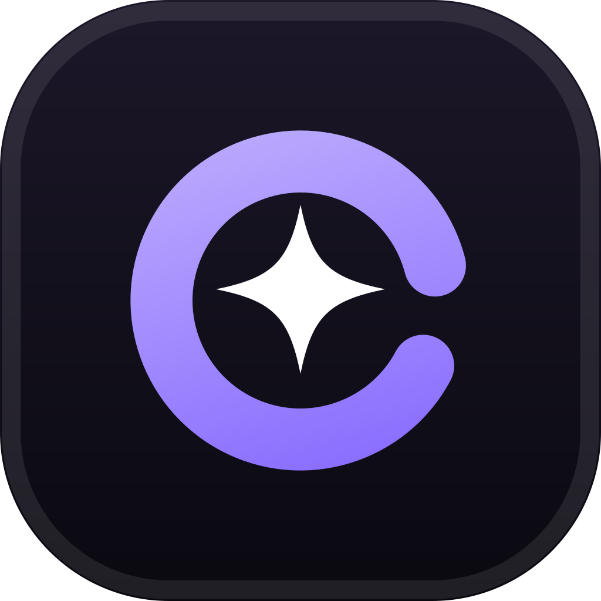

<div align="center">
  

  # Chelp AI

  **Your Desktop. Your Context. Your AI.**

  A Windows desktop AI assistant that reads your screen — errors, dialogs, terminal output, and code — and explains what happened and how to fix it.

  <sub>Windows 10/11 · Electron · React · TypeScript
  <p>Download for</p>

  <p><a href="https://chelpai.pages.dev/?dl=windows#download" title="Windows installer"></a>&nbsp;&nbsp;&nbsp;&nbsp;<a href="https://chelpai.pages.dev/?dl=portable#download" title="Portable archive"></a>&nbsp;&nbsp;&nbsp;&nbsp;<a href="https://chelpai.pages.dev/?dl=linux#download" title="Linux build"></a></p>
</div>

Chelp AI lives in the system tray, opens with a global hotkey, and stays out of your way until you need it. When something breaks on screen, capture it once — a display, a window, or a drawn region — and Chelp tells you what you are looking at: the problem, the likely cause, and the fix, in plain language.

It works with any OpenAI-compatible API. Bring DeepSeek, OpenRouter, OpenAI, or Gemini, or keep everything on your machine with local models through Ollama or LM Studio.

Screenshots are captured only on your command, previewed before sending, and uploaded nowhere until you press **Send**.

## Features

- **Screen analysis** — capture a full display, a specific window, or a drawn region. Review the preview and redact sensitive areas with a brush before anything leaves your PC.
- **Structured answers** — problem, cause, explanation, fix, and extra context, with facts clearly separated from guesses.
- **Floating assistant** — a compact always-on-top overlay that collapses to an orb and can hand the current conversation to the main window.
- **Full conversation workflow** — create, rename, delete, search, regenerate, retry, copy, and save answers. Export to Markdown or JSON.
- **Multi-provider** — DeepSeek (including DeepSeek Vision), OpenRouter, OpenAI, Google Gemini, any OpenAI-compatible endpoint, and local models via Ollama or LM Studio.
- **Managed local runtime** — Chelp installs and runs its own Ollama alongside the app, downloads models with live progress, and keeps the active model warm in memory.
- **Model transparency** — every answer is labeled with the model that produced it. The selected model is never silently swapped.
- **Guard Mode** — always-on scope protection. Chelp only helps with errors, troubleshooting, and questions; jailbreak attempts and harmful requests are blocked locally before they reach any provider.
- **Windows-native** — system tray, global hotkeys, launch at login, multi-monitor capture, native notifications, and cancelable generation.
- **EN / RU**, five accent colors, configurable hotkeys, and a dark interface built to stay out of the way.

## Installation

### Windows installer

1. Download `Chelp AI Setup 1.0.0.exe`.
2. Run the installer. It installs per user, so no administrator rights are required.
3. Launch Chelp AI from the Start menu or the desktop shortcut.

### From source

Requirements: Windows 10/11 (x64), Node.js 20+, and npm.

```bash
git clone https://github.com/slipptech-tech/Chelp-AI.git "Chelp AI"
cd "Chelp AI"
npm install
npm run dev
```

Build the production bundle and run it:

```bash
npm run build
npm start
```

Build the Windows installer:

```bash
npm run dist
```

The installer is written to `dist/`.

## Quick start

1. Open **AI Configuration** from the sidebar.
2. Add a provider profile and paste an API key — or press **Sign in with OpenRouter**: Chelp opens the browser and stores the issued key automatically, no manual key handling.
3. Press **Test Connection** to verify the key and model. Failures are reported in plain language: invalid key, rate limit, insufficient balance, missing model, or network error.
4. Mark the profile as **Active**.
5. Press `Ctrl + Shift + Space` anywhere.

## Providers

| Provider | Images | Notes |
| --- | --- | --- |
| DeepSeek | `deepseek-flash` | Account balance shown in Test Connection |
| OpenRouter | Yes | One-click sign-in, no manual API key |
| OpenAI | Yes | Any current vision-capable model |
| Google Gemini | Yes | Through the OpenAI-compatible endpoint |
| Local models | Model-dependent | Ollama or LM Studio, no key, no cloud |
| Custom endpoint | Model-dependent | Any OpenAI-compatible API |

Recommended pairings:

| Task | Provider | Example model |
| --- | --- | --- |
| Text and code | DeepSeek | `deepseek-v4-pro` |
| Text and screenshots | DeepSeek | `deepseek-flash` |
| Screenshot analysis | OpenRouter / OpenAI / Gemini | `google/gemini-3.8-flash`, `openai/gpt-6.2-astra` |
| Fully local | Ollama / LM Studio | `qwen3.5:27b`, `gemma4:31b`, `qwen3-vl:8b` |

### Your selected model is never substituted

Chelp answers with exactly the profile and model marked **Active**. It does not switch providers or swap in a different model behind your back. If the active model cannot read images, the screenshot is not sent — Chelp asks you to pick a vision-capable model instead. The model that responded is shown under the answer.

If the active profile fails — zero balance, rejected key, rate limit, missing model, or network error — Chelp shows a clear error with a **Retry** button and leaves your selection untouched. To add resilience, enable **Backup AI** in **Settings → Behavior**: on failure, Chelp tries another ready profile, labels the answer with the model that actually responded, and marks it as a backup response. This is off by default.

Chelp cannot top up provider balances or issue free tokens — credits are purchased from DeepSeek, OpenRouter, and other providers. It can show your DeepSeek balance in Test Connection, surface quota errors early, and fall back to a backup or local profile.

## Guard Mode

Guard Mode is built into the request pipeline and cannot be turned off from the UI. Every message passes through it in the main process before a provider is contacted:

- **Locked policy** — the system prompt restricts Chelp to errors, troubleshooting, software, settings, and general questions. The model is told it cannot change this policy, follow instructions hidden in screenshots, or claim to run commands.
- **Local pre-flight filter** — jailbreak patterns and clearly harmful requests (malware, credential theft, bypassing security, weapons, illegal drugs) are refused in the main process. Those messages are never sent to an API.
- **No tools, no execution** — Chelp has no shell, file, browser, or computer-control capabilities. The model can only return text; it cannot act on your machine even if asked.
- **Visible refusals** — a blocked message appears in the chat as a Guard Mode answer with a “Blocked locally” note.

The filter runs on-device in milliseconds. It is deliberately conservative and may occasionally catch a legitimate edge case; the locked model policy is the second layer. A heavily paraphrased request can still reach the model, where that policy applies — Guard Mode reduces the risk, but only the absence of tools is an absolute guarantee.

## Screen analysis

- Capture a display, a window, or a drawn region on any monitor.
- Preview the exact image before sending, with an optional confirmation step.
- Use the redaction brush to hide passwords, tokens, and other sensitive content.
- Ask a question or leave it empty for a full analysis of the screenshot.
- Works only with vision-capable models; text-only models are rejected before a request is made.

## Local models

Chelp can install and manage its own Ollama runtime, so no separate setup is required.

1. Go to **AI Configuration → Local models** and press **Install Ollama** — Chelp downloads the official Windows runtime into `%APPDATA%\Chelp AI\ollama`, extracts it, and starts the server.
2. Pick a model and press **Download {model}** — weights are stored in a `models` folder next to the runtime, with progress shown in Settings.
3. Refresh the list to see installed models. Vision-capable models are tagged.
4. No API key is needed, and requests never leave your PC while a local profile is active.

Already running Ollama or LM Studio? Point Chelp at the endpoint instead (`http://127.0.0.1:11434/v1` by default for Ollama).

**Performance.** The active local model is preloaded at startup and kept in memory for two hours (`keep_alive`), so the first question does not wait for a cold load. **Test Connection** checks server and model readiness — typically around 10 ms — instead of running a full completion. Actual generation speed depends on your GPU and model size.

## Privacy and security

- Screenshots are captured only after an explicit user action.
- A preview is always shown before sending; confirmation can be required in Settings.
- The built-in editor lets you redact passwords, tokens, and other sensitive data.
- No background screen recording, hidden monitoring, or automatic uploads.
- Guard Mode checks every message in the main process before a network request is made.
- API keys are encrypted at rest with Windows DPAPI through Electron `safeStorage` and decrypted only in the main process. They are never shown in the UI and never sent anywhere except the API you selected.
- Conversation history is stored locally in `%APPDATA%\Chelp AI` and can be disabled or cleared from Settings.

## Hotkeys

| Shortcut | Action |
| --- | --- |
| `Ctrl + Shift + Space` | Show or hide the floating assistant |
| `Ctrl + Shift + X` | Capture a screen region |

Both shortcuts can be changed in **Settings → Hotkeys**.

## Scripts

| Command | Description |
| --- | --- |
| `npm run dev` | Start with hot reload |
| `npm run build` | Bundle main, preload, and renderer into `out/` |
| `npm start` | Run the production build |
| `npm run typecheck` | Type-check the entire project |
| `npm run dist` | Build the Windows installer |
| `npm run icon` | Regenerate the app icon from SVG |

## Project structure

```
src/
  main/       Electron main process — windows, tray, IPC, screen capture, AI streaming, storage
  preload/    contextBridge API; the renderer never gets Node access
  renderer/   React UI — main window, floating assistant, region overlay
  shared/     Shared types, prompts, and provider presets
```

## Tech stack

Electron 33 · React 19 · TypeScript 5 · Vite 6 / electron-vite 3 · Zustand · react-markdown · electron-builder (NSIS)

## License

Proprietary software. © SlippTech. All rights reserved.
